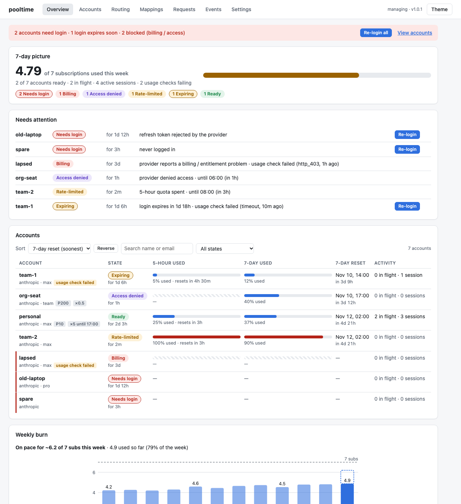

# pooltime

**One local endpoint for all your Claude and ChatGPT subscriptions.** pooltime pools several Claude
Max/Pro and ChatGPT (Codex) accounts behind `http://127.0.0.1:3460`, an Anthropic-compatible API that
Claude Code talks to as if it were Anthropic. Each request goes to a healthy account with headroom
left, conversations stay on the account they started on, and when one account hits its limit the
next one takes over.

Why: if you run Claude Code all day across several subscriptions, you stop juggling logins and
`/login`s. pooltime refreshes sign-ins, tracks every account's 5-hour and 7-day limits, warns before a
login expires, shows what you used this week, and points your Claude Code profiles at the pool (and
restores them when you disconnect). It runs on macOS and Linux, and replaces the pool in bro-cli.



> **Terms of service.** Pooling consumer subscription accounts may violate the providers' terms of
> service. Whether and how you use pooltime with your accounts is your responsibility.

## 60-second quickstart

```sh
brew install chrisjenx/tap/pooltime
# or: curl -fsSL https://raw.githubusercontent.com/chrisjenx/pooltime/main/install.sh | sh

pooltime setup
```

The wizard is safe to re-run. It imports from bro-cli if it finds it (or signs in your first Claude
account), installs the background service, connects the Claude Code profiles you pick, runs
`pooltime doctor` and prints the dashboard URL. Then just run `claude`.

Add more accounts any time:

```sh
pooltime accounts login work                               # Claude
pooltime accounts add codex-1 --provider openai --login    # ChatGPT / Codex
```

## Set it up with your coding agent

Paste this into Claude Code (or any coding agent):

```text
Set up pooltime for me by following https://raw.githubusercontent.com/chrisjenx/pooltime/main/llms.txt
Ask me which Claude Code profiles to connect and which accounts to add, and tell me when I need to
sign in in the browser. Never print tokens or key files.
```

## Everyday commands

```sh
pooltime status                       # accounts, 7-day headroom, alerts
pooltime accounts list                # every account and its state
pooltime accounts relogin --dead      # re-sign-in every account that needs it, one after another
pooltime connect default --statusline --mcp   # status line segment + MCP tools in a profile
pooltime open                         # dashboard
pooltime doctor                       # what is wrong and how to fix it
pooltime logs --request <id>          # why did this request fail
```

`pooltime --help` lists everything.

## Docs

| | |
|---|---|
| [Install](docs/install.md) | Homebrew, script, source; the background service; data dir |
| [Accounts](docs/accounts.md) | add Claude and Codex accounts, states, priority and weight |
| [Re-login](docs/relogin.md) | expiring logins, batch re-login, headless/SSH sign-in, notifications |
| [Dashboard](docs/dashboard.md) | what each view shows |
| [Claude Code profiles](docs/profiles.md) | connect/disconnect, status line, MCP |
| [Debugging](docs/debugging.md) | find and explain a failed request, debug mode, doctor |
| [Configuration](docs/configuration.md) | every `config.toml` key and `POOLTIME_*` variable |
| [Retention](docs/retention.md) | what is kept on disk and for how long |
| [Migrating from bro](docs/migrating-from-bro.md) | import and cutover |
| [Architecture](docs/architecture.md) · [Adding a provider](docs/adding-a-provider.md) · [AGENTS.md](AGENTS.md) | for contributors |
| [llms.txt](llms.txt) | non-interactive setup for agents |

These docs describe the `main` branch (v1.0.0); see [Install](docs/install.md) for what v0.1.0 lacks.

## Privacy

No telemetry: pooltime talks only to the providers' APIs (and GitHub's release API from
`pooltime doctor`). It never logs or stores prompts, responses, tokens or
upstream error messages; the dashboard, management API and MCP listen on 127.0.0.1 and require a
local key for changes.

## License

[MIT](LICENSE)
