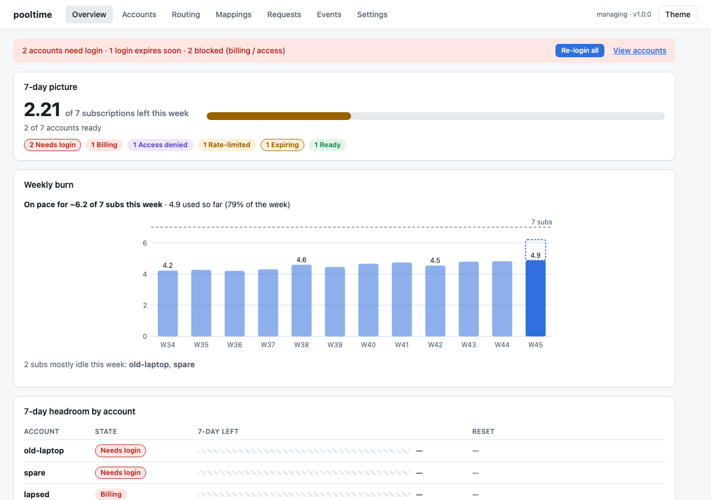
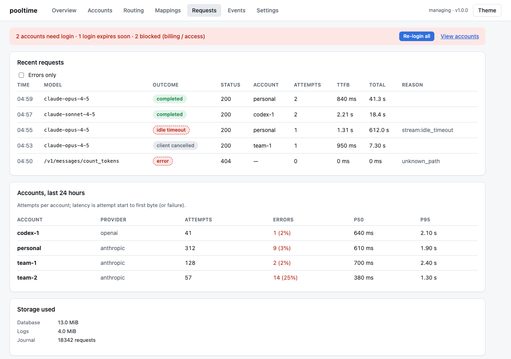

# Dashboard

The dashboard is built into the daemon: plain HTML and JavaScript served from
`http://127.0.0.1:3460/`, nothing loaded from anywhere else.

```sh
pooltime open
```

`open` prints `http://127.0.0.1:<port>/?k=<key>` and opens it. The key (`~/.pooltime/run/mgmt.key`)
is traded for a browser-session cookie on first load and removed from the address bar. Opened
without the key, the page is **read-only**: it shows the status overview only, with a hint to run
`pooltime open`. Requests whose `Host`/`Origin` is not `127.0.0.1:<port>` or `localhost:<port>` are
refused.



## Views

| View | What it shows / does |
|---|---|
| **Overview** | Alert banner ("2 accounts need login · 1 login expires within 3 days", **Re-login all**); the 7-day picture (subscriptions' worth of headroom left this week, accounts by state); 7-day headroom and reset time per account; accounts by severity with why and since when; weekly burn (subscriptions used per week, this week's forecast) |
| **Accounts** | One card per account: state, since when and why, login expiry, routing, in-flight requests and sessions, last error, usage per window; **Re-login** (and **Recheck billing** for `billing`) |
| **Routing** | Priority, weight and temporary weight overrides ("until"); routing tuning (`min_headroom`, `five_hour_exp`, `headroom_taper_start`) |
| **Mappings** | Map a Claude model family (e.g. `opus`) to a Codex route; on/off switch |
| **Requests** | Recent requests (filter to errors), click one for its attempt chain; per-account error rate and p50/p95 latency over 24 h; storage used |
| **Events** | Every account state change, newest first, with the reason |
| **Settings** | Connected Claude Code profiles (connect / disconnect); about: version, data dir, theme |

Requests, Events and the weekly burn need the key (they are not in the read-only view).



## Reading the overview

- **7-day left** is the account's remaining headroom in its provider's weekly window, as a
  percentage. The pool total adds them up as "N of M subscriptions left this week" (one account =
  one subscription).
- An account that is not usable (`needs_login`, `billing`, `access_denied`) shows a hatched bar and
  `—`, never stale headroom.
- Accounts sort most severe first; each shows the classified reason (e.g. "refresh token rejected
  by the provider") and how long it has been in that state.

State words are the same everywhere; see [Accounts](accounts.md#look-at-them).

## Screenshots without real accounts

For development, `POOLTIME_FIXTURE_STATE=<file.json>` makes `pooltime serve` answer the dashboard's
reads from a fixture document instead of live state. Never point it at real data.

Related: [Debugging](debugging.md) (the Requests view in depth), [Accounts](accounts.md).
