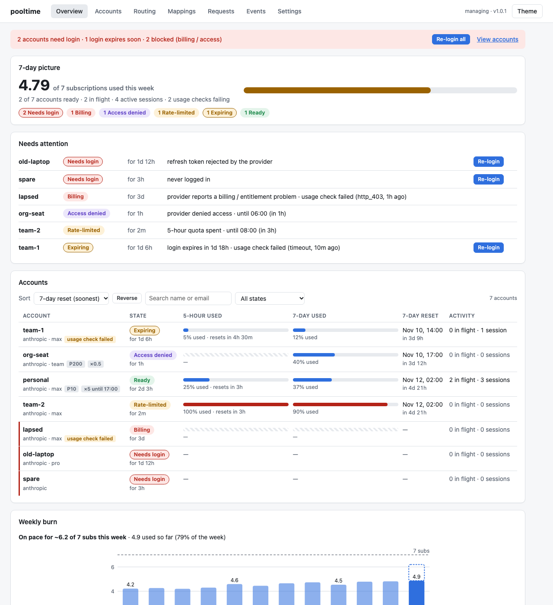
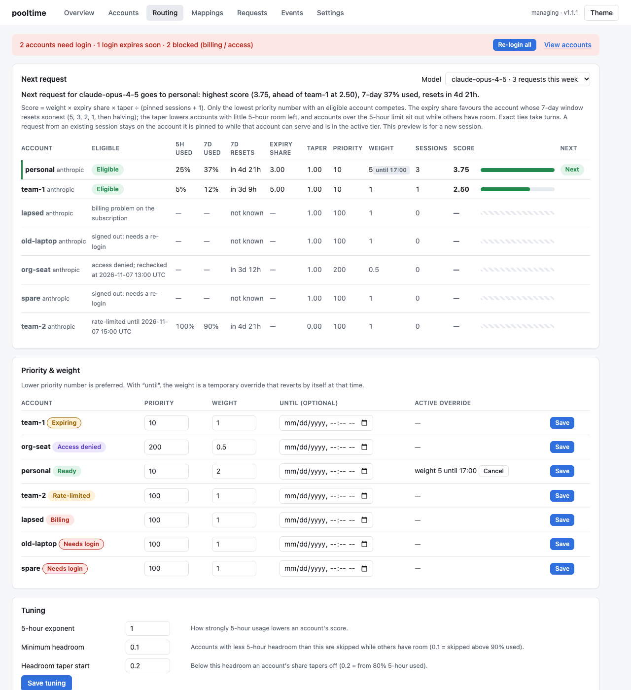
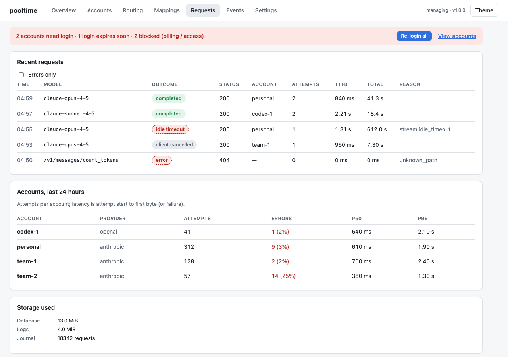
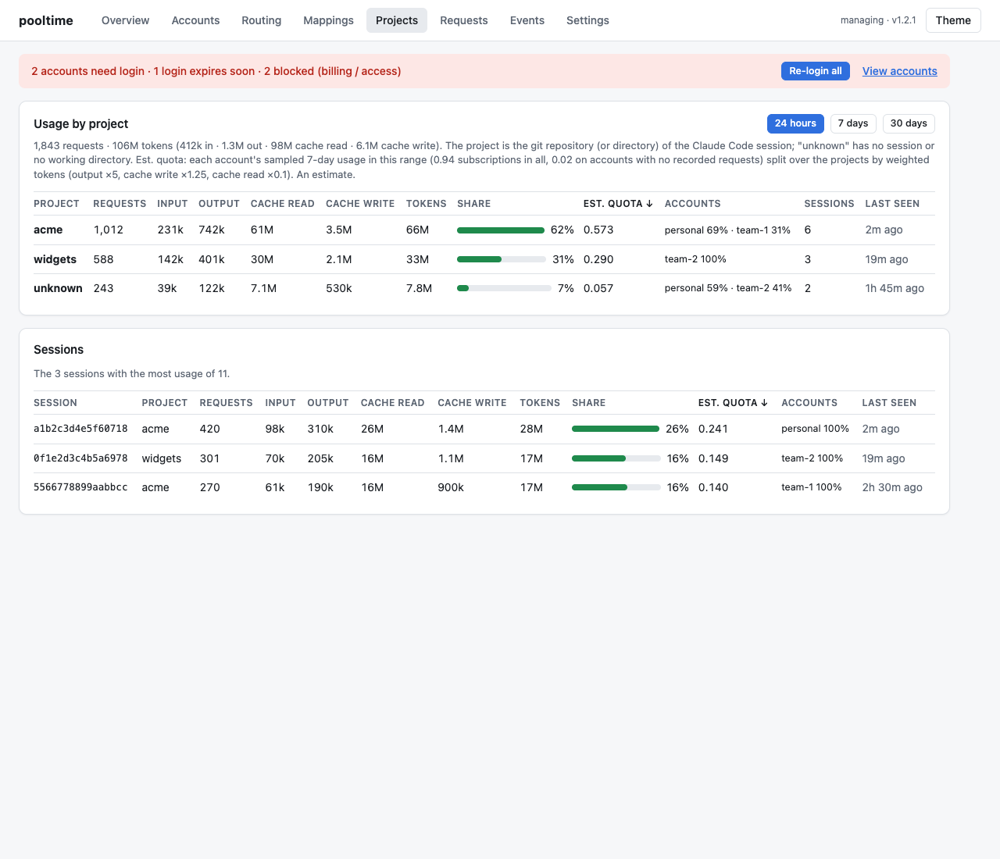

# Dashboard

The dashboard is built into the daemon: plain HTML and JavaScript served from
`http://127.0.0.1:3460/`, nothing loaded from anywhere else.

```sh
pooltime open
```

`open` prints `http://127.0.0.1:<port>/?k=<key>` and opens it. The key (`~/.pooltime/run/mgmt.key`)
is traded for a browser-session cookie on first load and removed from the address bar. Opened
without the key, the page is **read-only**: it shows the status overview only, with a hint to run
`pooltime open`. Requests whose `Host`/`Origin` is not `127.0.0.1:<port>` or `localhost:<port>` are
refused.



## Views

| View | What it shows / does |
|---|---|
| **Overview** | Alert banner ("2 accounts need login · 1 login expires within 3 days", **Re-login all**); the 7-day picture (subscriptions' worth of usage this week, "1.79 of 7 subscriptions used", with a bar that fills as it grows; accounts ready, in-flight requests, active sessions, failing usage checks, accounts by state); **Needs attention** (every account that is not ready, has a login expiring soon or a failing usage check, most severe first, with why and since when); the accounts table (plan, non-default routing, 5-hour and 7-day usage, 7-day reset, activity), sortable and filterable; weekly burn (subscriptions used per week, this week's forecast, and the [runway](relogin.md#runway-forecast): whether the 7-day quota lasts at the current rate or how long before the next reset it runs out, `⚠` when at risk) |
| **Accounts** | One card per account, same sort and filters as the Overview: state, since when and why, plan and rate tier, 7-day usage and reset, login and access-token expiry, routing, in-flight requests and sessions, last used, requests and tokens (current window and all time), last error, usage per window with when it was last checked; **Re-login** (and **Recheck billing** for `billing`) |
| **Routing** | **Next request**: pick a model (defaults to the most requested Claude model this week) to see which account its next request goes to and why, in one line ("Next request for claude-opus-4-5 goes to personal: highest score (3.75, ahead of team-1 at 2.50), 7-day 37% used, resets in 4d 21h."), then one row per account: eligible or why not, 5-hour and 7-day used, 7-day reset, expiry share, taper, priority, weight (with any override), pinned sessions, score with a bar, and the **Next** marker. Below: priority, weight and temporary weight overrides ("until"); routing tuning (`min_headroom`, `five_hour_exp`, `headroom_taper_start`) |
| **Mappings** | Map a Claude model family (e.g. `opus`) to a Codex route; on/off switch |
| **Projects** | Usage by project and by session over the last 24 hours, 7 days or 30 days: requests, input / output / cache tokens, share of all tokens, estimated quota, the accounts that served them, sessions and last seen; both tables sort by any column (click a header, again to reverse), most usage first by default |
| **Requests** | Recent requests (filter to errors), click one for its attempt chain; per-account error rate and p50/p95 latency over 24 h; storage used |
| **Events** | Every account state change, newest first, with the reason |
| **Settings** | Connected Claude Code profiles (connect / disconnect); about: version, data dir, theme |

Projects, Requests, Events, the weekly burn and the routing preview need the key (they are not in
the read-only view).

## Reading the Routing view



The **Next request** panel asks the daemon (`GET /api/v1/routing/preview`) what its router would
do with a new session's request for the chosen model right now, using the same code path as a real
request, without changing anything. It refreshes with the rest of the page.

- **Score** = weight × expiry share × taper ÷ (pinned sessions + 1). The highest score among the
  eligible accounts wins; exact ties take turns (the row is marked **tied**). The turn is shared
  by all traffic, so for tied accounts the **Next** marker is a snapshot: any request in between
  moves it. Likewise, when every account is at its in-flight cap the request waits and picks
  again, so it may go to whichever account frees up first.
- **Expiry share** favours the account whose 7-day window resets soonest: 5 for the soonest reset,
  then 3, 2, 1 and halving. An account with no known reset yet ranks first (it gets probed).
- **Taper** is 1.00 until the 5-hour window is 80% used (`headroom_taper_start` 0.2), then falls
  towards 0. Above 90% used (`min_headroom` 0.1) the account sits out while others have room.
- **Priority**: only the lowest priority number that has an eligible account competes; the others
  show "priority 100 is a reserve".
- **Sessions** are the conversations pinned to the account. They lower its score for new sessions,
  and a pinned conversation keeps its account while that account can serve and is in the active
  tier.
- **Eligible** shows why an account is out: signed out, rate-limited until a time, billing, access
  denied, the model family's limit used up, at its in-flight cap, a reserve tier, over the 5-hour
  limit, or (for a family mapped to Codex) the other provider serving first.



## Reading the Projects view



The Projects view answers "which repos and sessions are eating quota". The same report is
`GET /api/v1/analytics/projects?range=24h|7d|30d` (management key), the MCP tool
`usage_by_project`, and the `top projects 24h: ...` line of `pooltime status`.

- **Project** is the git repository the Claude Code session works in, found from the working
  directory in Claude Code's system prompt (its environment block). Subdirectories and
  worktrees (including `.claude/worktrees/<name>`) count as their repository. Without a git
  repository it is the directory itself. Two projects with the same name get a short suffix
  (`acme (3f2a)`). **unknown** collects requests that named no working directory and whose
  session (`metadata.user_id`) never did either, and requests from `/`.
- Each request counts for the directory it names, so one session id used from several
  directories is split between them. A request that names none (title generation, quota checks)
  counts for the directory its session named last before it, else the session's first one.
- The project of a new directory is looked up in the background, never on the request's path;
  a filesystem that does not answer within 2 seconds (a stalled network mount) gets the
  path-only answer.
- **Share** is of all tokens (input, output, cache read, cache write) in the range.
- **Est. quota** is in subscriptions (1.000 = one account's whole 7-day window). Each account's
  sampled 7-day usage that rose within the range is split over the projects it served, in
  proportion to their weighted tokens on that account: input ×1, output ×5, cache write ×1.25,
  cache read ×0.1 (the ratio of Anthropic's API prices). It is an estimate: usage is sampled per
  account, not metered per request. Usage on accounts with no recorded requests in the range is
  reported as unattributed. With no usage history in the range the column shows "—" and the
  tables sort by tokens.
- **Accounts** lists the serving accounts with their share of the line's tokens.
- **Sessions** shows the 50 sessions with the most usage, by session hash (the same hash as in a
  request's attempt chain on the Requests view).

Privacy: only a hash of each request's working directory, and per directory the project name
and a hash of its path are stored (locally: `journal_requests.cwd_hash` and the `cwd_projects`
table), never the path; they are pruned with the journal (see
[Retention](retention.md)).

## Reading the overview

- **7-day used** is how much of the account's provider weekly window is spent, as a percentage
  ("40% used"), like the usage page on claude.ai. Bars fill from empty to full as usage grows:
  blue while there is room, amber from 60% and red from 85%. The pool total adds the accounts up
  as "N of M subscriptions used this week" (one account = one subscription; an account that is
  logged out or has no 7-day window yet has no headroom and counts as fully used). The JSON API
  keeps `seven_day_left` (the complement) next to `seven_day_used`.
- An account that is not usable (`needs_login`, `billing`, `access_denied`) shows a hatched bar and
  `—`, never stale usage.
- Accounts are listed soonest 7-day reset first (the subscription to use up before it resets).
  Accounts with no known 7-day reset, including every `needs_login` one, come after, by name. The
  **Sort** menu also orders by 7-day used, 5-hour used (most used first), state, name or activity
  (**Reverse** flips it); the choice is remembered in the browser (`pooltime-sort` in
  localStorage; a choice saved by an older version as "7-day left" or "5-hour left" keeps its order). Search and the
  state / provider menus filter the list.
- **Needs attention** always lists the accounts that need a look most severe first (needs login on
  top), with the classified reason (e.g. "refresh token rejected by the provider") and how long it
  has been in that state.
- A reset time that has already passed (no usage check since) is shown rolled forward one window
  and marked "assumed"; a reset pooltime made up for a spent window is marked "estimated".

State words are the same everywhere; see [Accounts](accounts.md#look-at-them).

## Screenshots without real accounts

For development, `POOLTIME_FIXTURE_STATE=<file.json>` makes `pooltime serve` answer the dashboard's
reads from a fixture document instead of live state. Never point it at real data. The screenshots
here come from `tests/support/fixtures/dashboard.json` served that way (with a throwaway
`POOLTIME_HOME` and port), captured with headless Chrome (`--headless --screenshot`, 1280 px wide).

Related: [Debugging](debugging.md) (the Requests view in depth), [Accounts](accounts.md), [parity with bro's dashboard](dashboard-parity.md).
